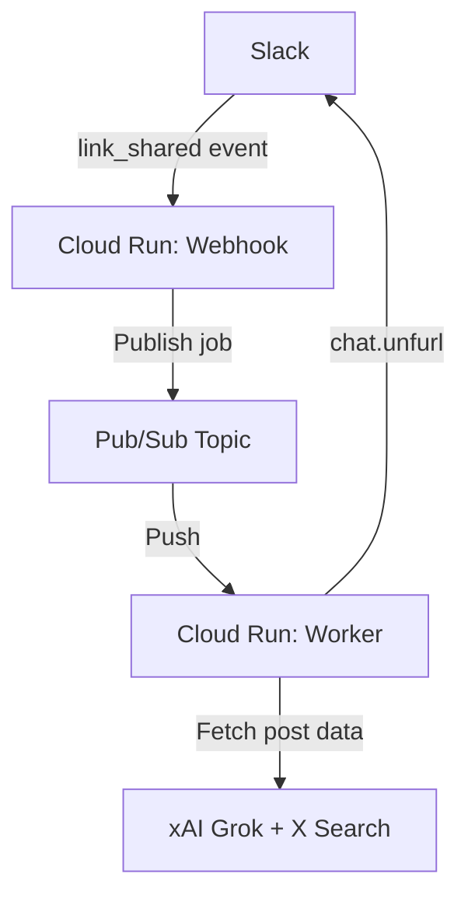

# X Unfurls

Grok-Powered Rich X (Twitter) Unfurls for Slack — Inline, Zero-Action, No Collateral Damage

## Overview

This Slack app automatically generates rich inline previews of X/Twitter links using xAI's Grok and X Search tools. When a user posts an X link in Slack, they automatically get a rich preview with:

- Author info + verified badge
- Full post text
- Media (images, video thumbnails)
- Engagement metrics (likes, reposts, replies, views)
- Top replies
- Optional Grok summary

**Key Features:**
- ✅ Inline unfurls (no thread replies)
- ✅ Zero user action required
- ✅ Doesn't break other link previews
- ✅ Deployed on GCP (Cloud Run + Pub/Sub)
- ✅ Clean architecture with repository pattern

## Architecture



## Prerequisites

- Python 3.12+
- [uv](https://docs.astral.sh/uv/) package manager
- GCP project with billing enabled
- Slack workspace (admin access for app installation)
- xAI API key

## Development Setup

1. **Install dependencies:**
   ```bash
   uv sync
   ```

2. **Set up environment variables:**
   ```bash
   cp .env.example .env
   # Edit .env with your credentials
   ```

3. **Run tests:**
   ```bash
   uv run pytest
   ```

4. **Run linting:**
   ```bash
   uv run ruff format src/ tests/
   uv run ruff check src/ tests/
   uv run mypy src/
   ```

## Deployment

See [DEPLOYMENT.md](DEPLOYMENT.md) for detailed deployment instructions.

Quick steps:
1. Set up GCP infrastructure with Terraform
2. Configure GitHub Actions secrets
3. Push to main branch to trigger deployment

## Project Structure

```
src/
  shared/                    # Shared domain and infrastructure
    domain/
      dtos.py               # Data transfer objects
      repositories/         # Repository protocols
    infrastructure/
      logging.py            # Structured logging
  xunfurls/                 # X unfurls feature
    domain/
      entities.py           # Domain entities
      repositories/         # Domain protocols
    application/
      services/             # Business logic
      presenters/           # Slack block builders
    infrastructure/
      gcp/                  # GCP-specific implementations
infra_gcp/
  terraform/                # Terraform IaC
```

## License

MIT
